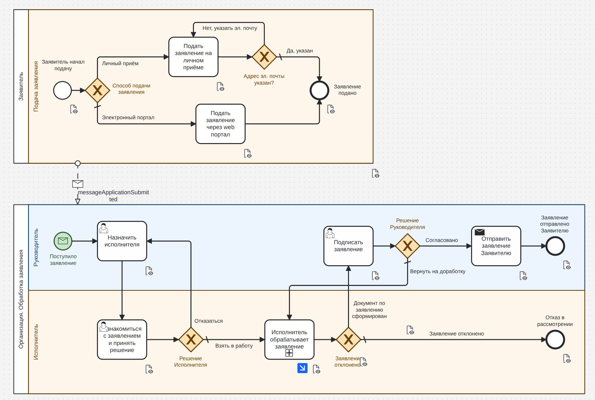
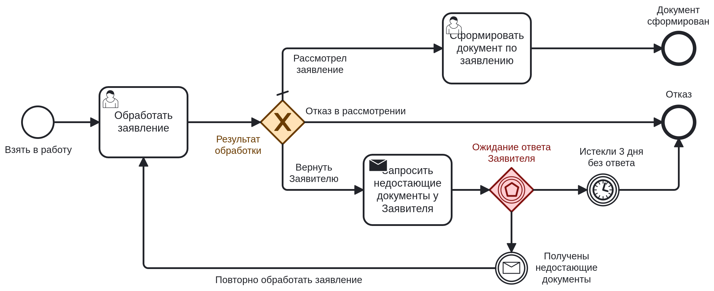
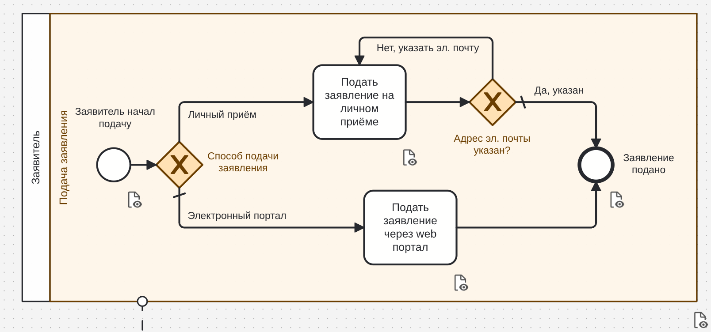
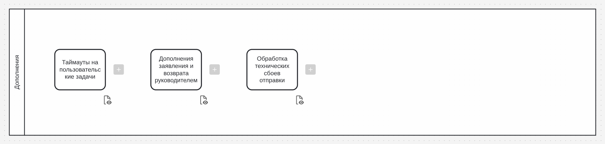
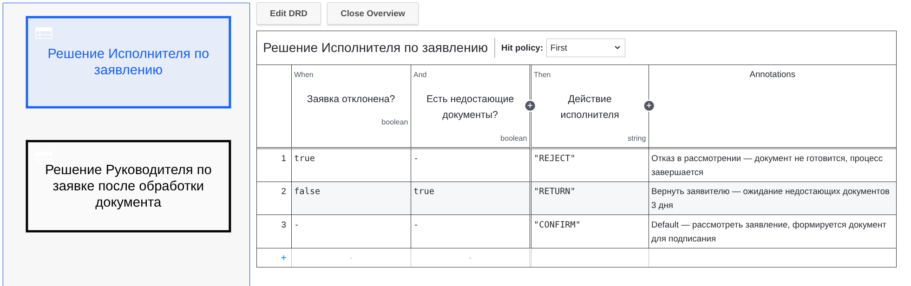
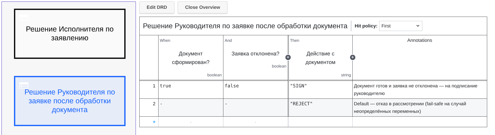

# Обработка электронного заявления

Тестовое задание на позицию **Старший бизнес-аналитик**. BPMN-модель процесса обработки электронного заявления, реализованная в **Camunda 8 (Zeebe)**.

**Автор:** Владимир Корес (Vladimir Cores)

## Содержание

- [Задание](#задание)
- [Скриншоты](#скриншоты)
- [Описание решения](#описание-решения)
- [Структура репозитория](#структура-репозитория)
- [Переменные процесса](#переменные-процесса)
- [Метрики процесса](#метрики-процесса)
- [Карта цветов BPMN](#карта-цветов-bpmn)
- [Матрица тестовых сценариев](#матрица-тестовых-сценариев)
- [Roadmap / возможные улучшения](#roadmap--возможные-улучшения)
- [Как запустить](#как-запустить)
- [Ограничения и допущения](#ограничения-и-допущения)
- [Приложение A. Легенда и глоссарий](#приложение-a-легенда-и-глоссарий)

---

## Задание

1. **Заявитель** подаёт электронное заявление в организацию — через личный приём (обязательное указание email) или через электронный портал.
2. **Руководитель** назначает исполнителя. Исполнитель может отказаться (заявление возвращается руководителю) или взять в работу.
3. При обработке **Исполнителем** возможны три варианта:
   - отказать в рассмотрении — документ не готовится, процесс завершается;
   - вернуть заявителю для предоставления недостающих документов (ожидание 3 дня, иначе отказ);
   - рассмотреть — формируется документ для согласования с руководителем.
4. **Руководитель** подписывает документ либо возвращает исполнителю на доработку.
5. После подписания заявление отправляется заявителю, процесс завершается.

---

## Скриншоты

### Общий вид процесса



### Подпроцесс «Исполнитель обрабатывает заявление»



### Пул «Заявитель»



### Пул «Дополнения» (backlog)



### DMN-таблицы решений




---

## Описание решения

Ссылка на решение в Camunda SaaS: [ссылка](https://hub.camunda.io/share/a8bcd903-b16e-48fa-86e7-d9d3f821929b)

Процесс реализован как BPMN-коллаборация из трёх пулов:

| Пул | Исполняемый | Назначение |
|---|---|---|
| **Организация. Обработка заявления** | ✅ Да | Основной процесс: назначение, обработка, подписание, отправка |
| **Заявитель** | ❌ Нет | Справочная модель каналов подачи (личный приём / портал) |
| **Дополнения** | ❌ Нет | Backlog открытых вопросов и улучшений (см. [Roadmap](#roadmap--возможные-улучшения)) |

### Ключевые архитектурные решения

1. **State-machine через `applicationStatus`** — переменная отражает текущий этап. Значения: `RECEIVED`, `ASSIGNED`, `IN_PROGRESS`, `WAITING_FOR_DOCUMENTS`, `DOCUMENT_READY`, `APPROVED`/`REWORK` (транзиентные), `SENT`, `REJECTED`. Используется внешними системами (Operate dashboard, BI, интеграции).

2. **Подпроцесс «Исполнитель обрабатывает заявление»** — изолирует логику обработки. Переиспользуется при возврате руководителем на доработку (второй входящий поток `Flow_Manager_ReturnForRework`).

3. **Event-based gateway** (`Gateway_Executor_WaitResponse`) — паттерн ожидания внешнего события: либо сообщение от заявителя (`CatchEvent_Executor_Message`), либо истечение 3 дней (`CatchEvent_Executor_Timer`). Первое наступившее отменяет второе.

4. **Output mapping подпроцесса** — переменные `isApplicationRejected`, `isDocumentReady`, `document`, `rejectionReason`, `applicantDocuments` явно поднимаются в родительский скоуп (обязательно для Camunda 8).

5. **`assert()` для критичных переменных** — `managerId` и `applicantEmail` валидируются на стартовом событии через `=assert(...)`. Fail-fast: если переменной нет — инцидент, а не «тихое» зависание.

6. **Разделение `form_*` переменных и бизнес-переменных** — входные переменные форм (`form_isApplicationApproved`, `form_documentText` и т.д.) не смешиваются с бизнес-переменными. Это позволяет менять UI-формы без риска сломать логику шлюзов.

7. **DMN-таблицы для сложных решений** — вынесены в `Test - DMN - Application Decisions.dmn` как справочный артефакт. Пока не подключены к BPMN через `businessRuleTask`, но готовы к интеграции (см. [Roadmap п.1](#1-интеграция-dmn-в-bpmn)).

**DMN-решения:**

| Решение | Входы | Выход | Использование |
|---|---|---|---|
| `Decision_ExecutorProcessing` | `isApplicationRejected`, `hasMissingDocuments` | `executorAction` (`REJECT` / `RETURN` / `CONFIRM`) | Соответствует `Gateway_Executor_ProcessingResult` |
| `Decision_DocumentSigning` | `isDocumentReady`, `isApplicationRejected` | `documentAction` (`SIGN` / `REJECT`) | Соответствует `Gateway_Check_Application_Rejection` |

---

## Структура репозитория

```
.
├── README.md
├── Test - Applicant Request Processing.bpmn       # Основная BPMN-модель
├── Test - DMN - Application Decisions.dmn         # DMN-таблицы решений (2 шт.)
├── Test - Form - Executor Confirmation.form
├── Test - Form - Executor Create Document.form
├── Test - Form - Executor Process.form
├── Test - Form - Manager Select Executor.form
├── Test - Form - Manager Sign Application.form
└── docs/
    └── План_тестирования_Обработка_электронного_заявления.docx  # Черновик плана тестирования
```

> **Примечание:** файлы форм расположены в корне репозитория (префикс `Test - Form - ...`). При деплое через Camunda Web Modeler они синхронизируются автоматически.

---

## Переменные процесса

### Входные (передаются при старте через сообщение `messageApplicationSubmitted`)

| Переменная | Тип | Обяз. | Описание |
|---|---|---|---|
| `managerId` | string | ✅ | ID руководителя (получателя задачи назначения) |
| `applicantEmail` | string | ✅ | Email заявителя для отправки результата |
| `applicationId` | string | — | Внешний ID заявки; если не передан — генерируется из `now()` |
| `documentVersion` | number | — | Начальная версия документа (по умолчанию `0`) |

### Внутренние (управляются процессом)

| Переменная | Тип | Назначение |
|---|---|---|
| `appId` | string | Уникальный ID процесса (для корреляции сообщений) |
| `executorId` | string \| null | Назначенный исполнитель |
| `isExecutorRejected` | boolean | Исполнитель отказался от назначения |
| `isApplicationRejected` | boolean | Заявка отклонена |
| `isApplicationApproved` | boolean | Руководитель согласовал |
| `isDocumentReady` | boolean | Документ сформирован |
| `hasMissingDocuments` | boolean | Требуются дополнительные документы |
| `rejectionReason` | string \| null | Причина отказа (`EXECUTOR_REJECTED`, `MISSING_DOCUMENTS_TIMEOUT`) |
| `document` | object \| null | `{version, appId, text}` |
| `applicantDocuments` | object \| null | Документы, предоставленные заявителем |
| `applicationStatus` | string | State-machine (см. выше) |

### Timestamp-переменные (для метрик)

| Переменная | Устанавливается в | Назначение |
|---|---|---|
| `documentReadyAt` | `Task_Executor_PrepareDocument` | Время готовности документа |
| `signedAt` | `Task_Manager_Sign` | Время подписания |
| `sentAt` | `Task_Manager_SendToApplicant` | Время отправки |

---

## Метрики процесса

| Метрика | Формула | Источник |
|---|---|---|
| **Cycle time** | `sentAt − RECEIVED_at` | Timestamp-переменные + Operate |
| **Время подписания** | `signedAt − documentReadyAt` | Timestamp-переменные |
| **Время отправки** | `sentAt − signedAt` | Timestamp-переменные |
| **Rework rate** | `documentVersion − 1` | `documentVersion` |
| **Rejection rate** | `count(isApplicationRejected=true) / count(instances)` | `applicationStatus = REJECTED` |
| **Rejection by reason** | Группировка по `rejectionReason` | `rejectionReason` |
| **Timeout rate** | `count(rejectionReason = "MISSING_DOCUMENTS_TIMEOUT")` | `rejectionReason` |
| **First-time-right** | `count(documentVersion = 1) / count(instances)` | `documentVersion` |

> **Edge-case:** отказ исполнителя после возврата на доработку **не отражается** в `documentVersion − 1` (документ не пересоздаётся). Осознанно вынесено за пределы основной метрики — задокументировано в `Flow_Manager_ReturnForRework`.

---

## Карта цветов BPMN

| Элемент | Цвет | Значение |
|---|---|---|
| **Дорожка «Руководитель»** | 🔵 Голубой (`#bbdefb`, обводка `#0d4372`) | Роль «Руководитель» |
| **Дорожка «Исполнитель»** | 🟠 Оранжевый (`#ffe0b2`, обводка `#6b3c00`) | Роль «Исполнитель» |
| **Дорожка пула «Заявитель»** | 🟠 Оранжевый (`#ffe0b2`) | Пул заявителя (справочный) |
| **`StartEvent_ApplicationReceived`** | 🟢 Зелёный (`#c8e6c9`, обводка `#205022`) | Точка входа процесса |
| **Все XOR-шлюзы** | 🟠 Оранжевый (`#ffe0b2`) | Точки принятия решений |
| **`Gateway_Executor_WaitResponse`** | 🔴 Красный (`#ffcdd2`, обводка `#831311`) | Ожидание внешнего события (message/timer) |
| **Остальные элементы** | ⚪ По умолчанию | Стандартные элементы BPMN |

**Логика:**
- 🔵 / 🟠 — цвет роли (кто выполняет задачу);
- 🟢 — единственный «зелёный» — старт процесса (визуальный акцент на точке входа);
- 🔴 — «горячие» точки ожидания внешнего события (требуют внимания при мониторинге);
- ⚪ — всё остальное.

---

## Матрица тестовых сценариев

> ⚠️ **Статус:** приведённая ниже матрица — **черновой набросок**, а не финальный план тестирования. Она покрывает ключевые happy-path и негативные сценарии, достаточные для проверки логики процесса в Camunda 8, но **не претендует на полноту**. Более детальный план тестирования (с шагами воспроизведения, ожидаемыми результатами, тестовыми данными и критериями приёмки) находится в файле [`docs/План_тестирования_Обработка_электронного_заявления.docx`](docs/План_тестирования_Обработка_электронного_заявления.docx). Он также носит характер **черновика** и подлежит уточнению после согласования с заказчиком.
>
> В финальной версии плана тестирования предполагается:
> - добавить шаги воспроизведения для каждого сценария;
> - зафиксировать конкретные тестовые данные (ID пользователей, email, номера заявок);
> - определить критерии приёмки (pass/fail) и метрики покрытия;
> - согласовать перечень сценариев с бизнес-заказчиком.

### Подача заявления

| ID | Сценарий | Входные данные | Ожидаемый результат | Проверки |
|---|---|---|---|---|
| **TC-01** | Подача через портал с email | `submissionChannel=ONLINE`, `profile.email` задан | Переход к `EndEvent_Applicant_Submitted` | `Flow_EmailCheck_Yes` |
| **TC-02** | Подача через личный приём с email | `submissionChannel=OFFICE`, `profile.email` задан | Переход к `EndEvent_Applicant_Submitted` | `Flow_EmailCheck_Yes` |
| **TC-03** | Подача через личный приём без email | `submissionChannel=OFFICE`, `profile.email` не задан | Возврат в `Task_Applicant_PersonalReception` | `Flow_EmailCheck_No` |
| **TC-04** | Отсутствует `managerId` при старте | Сообщение без `managerId` | Инцидент `EXTRACT_VALUE_ERROR` при старте | `assert()` на `StartEvent` |

### Назначение и принятие

| ID | Сценарий | Входные данные | Ожидаемый результат | Проверки |
|---|---|---|---|---|
| **TC-05** | Назначение + принятие | `form_executorId="user-exec-1"`, `form_isExecutorRejected=false` | Переход в `SubProcess_ExecutorWork` | `Flow_Executor_TakeToWork` (default) |
| **TC-06** | Назначение + отказ исполнителя | `form_isExecutorRejected=true` | Возврат в `Task_Manager_AssignExecutor` | `Flow_Executor_Rejection` |
| **TC-07** | Завершение формы без выбора исполнителя | `form_executorId=null` | Инцидент `assert` на `Task_Manager_AssignExecutor` | `assert()` в output mapping |
| **TC-08** | Повторное назначение после отказа | `form_isExecutorRejected=true` → новое назначение | `executorId` перезаписан | `Task_Manager_AssignExecutor` |

### Обработка исполнителем

| ID | Сценарий | Входные данные | Ожидаемый результат | Проверки |
|---|---|---|---|---|
| **TC-09** | Отказ в рассмотрении | `form_isApplicationRejected=true` | `EndEvent_Rejection`, `applicationStatus=REJECTED`, `rejectionReason=EXECUTOR_REJECTED` | `Flow_1v24gwl` |
| **TC-10** | Возврат документов → ответ получен | `form_hasMissingDocuments=true` → `messageApplicantMissingDocument` | Возврат в `Task_Executor_Process` | `Gateway_Executor_WaitResponse` + `CatchEvent_Executor_Message` |
| **TC-11** | Возврат документов → таймаут 3 дня | `form_hasMissingDocuments=true` → нет сообщения через `P3D` | `EndEvent_Rejection`, `rejectionReason=MISSING_DOCUMENTS_TIMEOUT` | `CatchEvent_Executor_Timer` |
| **TC-12** | Рассмотрение заявления | `form_isApplicationRejected=false`, `form_hasMissingDocuments=false` | `Event_Executor_DocumentReady`, `isDocumentReady=true`, `documentVersion += 1` | `Flow_Executor_ConfirmApplication` (default) |

### Подписание руководителем

| ID | Сценарий | Входные данные | Ожидаемый результат | Проверки |
|---|---|---|---|---|
| **TC-13** | Согласование | `form_isApplicationApproved=true` | `Task_Manager_SendToApplicant` → `EndEvent_Sent`, `applicationStatus=SENT` | `Flow_Manager_Approve` |
| **TC-14** | Возврат на доработку | `form_isApplicationApproved=false` | Возврат в `SubProcess_ExecutorWork` | `Flow_Manager_ReturnForRework` (default) |
| **TC-15** | Реворк → повторное согласование | `false` → реворк → `true` | `documentVersion=2`, `EndEvent_Sent` | `documentVersion` |
| **TC-16** | Реворк → отказ исполнителя | `false` → реворк → `form_isApplicationRejected=true` | `EndEvent_Rejection`, `documentVersion=1` | Edge-case метрики rework |

### Технические / негативные

| ID | Сценарий | Входные данные | Ожидаемый результат | Проверки |
|---|---|---|---|---|
| **TC-17** | `sendDocumentToApplicant` падает | Worker возвращает ошибку | 3 ретрая → инцидент | `retries="3"` |
| **TC-18** | `requestApplicantMissingDocuments` падает | Worker возвращает ошибку | 3 ретрая → инцидент | `retries="3"` |
| **TC-19** | Ответ заявителя с неверным `appId` | `correlationKey != appId` | Сообщение не коррелируется, процесс ждёт таймер | `correlationKey="=appId"` |
| **TC-20** | Корректный ответ заявителя | `messageApplicantMissingDocument` с `appId` | `CatchEvent_Executor_Message` срабатывает | Корреляция сообщений Zeebe |

---

## Roadmap / возможные улучшения

Сценарии **осознанно вынесены** из текущей реализации. Отражены в пуле **«Дополнения»** (`Participant_0aegb3e`, `isExecutable=false`) как явный backlog.

### 1. Интеграция DMN в BPMN

**Статус:** DMN-файл `Test - DMN - Application Decisions.dmn` присутствует в репозитории, но **не подключён** к BPMN.

**Проблема:** логика шлюзов `Gateway_Executor_ProcessingResult` и `Gateway_CheckApplication_Rejection` зашита в условиях потоков. При росте числа правил это трудно поддерживать.

**Решение:** заменить шлюзы на `businessRuleTask` + упрощённый XOR, используя `zeebe:calledDecision` с `decisionId="Decision_ExecutorProcessing"` / `"Decision_DocumentSigning"` и `resultVariable="executorAction"` / `"documentAction"`.

### 2. Таймауты на пользовательские задачи

**Проблема:** таймер есть только на ожидание документов (3 дня). У руководителя и исполнителя **дедлайнов нет** — «зависшие» задачи невидимы для мониторинга.

**Рекомендация:** **non-interrupting boundary timer** на каждую user task (например, `P2D` для напоминания) **или** регламент: «Таймауты не определены в требованиях — требуют согласования с заказчиком».

### 3. Самостоятельное дополнение и возврат руководителем

**Проблема:** возврат заявителю возможен **только** если исполнитель поставил `hasMissingDocuments=true`. Отсутствуют:
- возврат руководителем напрямую заявителю (сейчас — только исполнителю);
- самостоятельное дополнение заявки заявителем.

**Рекомендация:** расширить модель.

### 4. Обработка технических сбоев отправки (runbook)

**Проблема:** `retries="3"` настроены, но **runbook отсутствует**: что делать при исчерпании ретраев, кто эскалирует, какой SLA.

**Рекомендация — operational runbook:**
- При исчерпании `retries` → инцидент в Operate.
- Ответственный: дежурный администратор.
- SLA: 4 часа.
- Эскалация: email в техподдержку.
- Альтернатива: временная отправка вручную.

### 5. Дедупликация входящих сообщений

**Проблема:** повторная публикация `messageApplicationSubmitted` с тем же `applicationId` создаст второй экземпляр процесса.

**Рекомендация:** дедупликация на стороне источника (портал/приёмная) **или** `correlationKey` на стартовом сообщении с обязательной передачей `applicationId`.

---

## Как запустить

### 1. Деплой через Desktop Modeler

1. Открыть [Camunda Modeler](https://camunda.com/download/modeler/) (версия 5.x).
2. `File → Open File` → выбрать **`Test - Applicant Request Processing.bpmn`**.
3. Нажать **Deploy** → выбрать целевой кластер (Camunda 8 SaaS или Self-Managed).
4. Повторить для `Test - DMN - Application Decisions.dmn` (опционально — DMN не подключён к BPMN, но нужен как артефакт).
5. Формы синхронизируются автоматически при работе с Web Modeler.

### 1.1. Запуск через Web Modeler (Camunda SaaS)

Web Modeler — облачная версия Modeler, доступная в [Camunda SaaS Console](https://camunda.com/). Развернуть BPMN из репозитория GitHub можно тремя способами.

#### Способ A — Импорт по URL из GitHub (рекомендуемый)

Camunda Web Modeler поддерживает импорт ресурсов по публичному URL. Для GitHub-хостинга используется «raw»-ссылка на файл.

1. Откройте файл `Test - Applicant Request Processing.bpmn` в репозитории GitHub.
2. Нажмите кнопку **Raw** (справа над файлом) — откроется «сырой» URL вида:
   `https://raw.githubusercontent.com/VladimirCores/rost-test-analytic-applicant-request-processing/main/Test%20-%20Applicant%20Request%20Processing.bpmn`
3. В Web Modeler перейдите на **главную страницу** → **Import** → **From URL**.
4. Вставьте raw-URL и подтвердите импорт. Web Modeler распознает BPMN и создаст процесс-приложение[reference:0].
5. Повторите для DMN-файла и форм, если они нужны в проекте (каждый файл импортируется отдельно).

> **Важно:** URL должен быть **публично доступным** (без аутентификации, VPN или редиректов). Для приватных репозиториев используйте Git Sync (Способ C).

#### Способ B — Загрузка файлов (самый простой)

Если не хотите возиться с URL:

1. Скачайте BPMN-файл из репозитория (кнопка **Download raw file**).
2. В Web Modeler откройте проект (или создайте новый) → **New → Upload files** → выберите скачанный BPMN[reference:1].
3. Повторите для DMN и форм.

#### Способ C — Git Sync (автоматическая синхронизация)

Camunda Web Modeler поддерживает **Git Sync** — привязку процесса-приложения к GitHub-репозиторию. Это удобно, если планируете часто менять модель и держать её в Git как source of truth[reference:2].

1. В Web Modeler откройте или создайте **process application**.
2. Нажмите кнопку **Git** в правом верхнем углу → **Configure Git integration**.
3. Установите **Camunda Git Sync** GitHub App для вашего репозитория (потребуются права администратора).
4. Укажите базовый URL репозитория (без `.git` и без пути к папке):
   `https://github.com/VladimirCores/rost-test-analytic-applicant-request-processing`
5. Выберите ветку (`main`) и нажмите **Sync** — Web Modeler подтянет BPMN, DMN и формы из репозитория[reference:3].

> **Примечание:** Git Sync требует, чтобы организация Camunda поддерживала эту функцию (доступна в SaaS-планах). Если кнопка Git недоступна — используйте Способ A или B.

### 2. Запуск процесса (после деплоя)

После деплоя BPMN (любым из способов) процесс готов к запуску. Публикация стартового сообщения `messageApplicationSubmitted`:

```http
POST https://<cluster-id>.<region>.zeebe.camunda.io/v2/messages/publication
Content-Type: application/json

{
  "name": "messageApplicationSubmitted",
  "variables": {
    "managerId": "user-manager-1",
    "applicantEmail": "applicant@example.com",
    "applicationId": "APP-2025-0001"
  }
}
```

**Важно:** `managerId` и `applicantEmail` обязательны (валидируются через `assert()` на стартовом событии).

### 3. Тестирование

- Сценарии из [матрицы](#матрица-тестовых-сценариев) проверяются через **Tasklist** (задачи) и **Operate** (инциденты, переменные).
- Для проверки ответа заявителя (TC-10) — публикация `messageApplicantMissingDocument` с `correlationKey = appId`:

```http
POST /v2/messages/publication
{
  "name": "messageApplicantMissingDocument",
  "correlationKey": "APP-2025-0001",
  "variables": {
    "missingDocuments": { "doc1": "url-to-doc" }
  }
}
```

---

## Ограничения и допущения

1. **Пул «Заявитель» — неисполняемый** (`isExecutable=false`). Отражает каналы подачи как справочную модель. В production публикация `messageApplicationSubmitted` должна происходить из внешней системы (портал / приёмная).

2. **Пул «Дополнения» — неисполняемый.** Задачи — backlog-артефакт для фиксации out-of-scope сценариев. При деплое в некоторых версиях Camunda 8 abstract task (`bpmn:task`) может не пройти валидацию — в этом случае заменить на `bpmn:manualTask`.

3. **DMN не подключён к BPMN.** Используется как справочный артефакт; для интеграции требуется заменить шлюзы на `businessRuleTask` (см. [Roadmap п.1](#1-интеграция-dmn-в-bpmn)).

4. **`REWORK` — транзиентный статус.** Устанавливается в `Task_Manager_Sign` и сразу перезаписывается на `IN_PROGRESS`. Для аналитики используются timestamp-переменные.

5. **`rejectionReason` в success-path** сбрасывается в `null` на `Event_Executor_DocumentReady` (защита от «залипания»).

6. **Метрика rework** = `documentVersion − 1`. Edge-case «отказ после доработки» осознанно не отражается.

7. **План тестирования — черновик.** Файл `docs/План_тестирования_Обработка_электронного_заявления.docx` содержит предварительный набросок тестовых сценариев и подходов к проверке. Он **не является финальным планом тестирования** и требует доработки: детализации шагов, фиксации тестовых данных, согласования с заказчиком и определения критериев приёмки. Матрица в разделе [Матрица тестовых сценариев](#матрица-тестовых-сценариев) — её краткая выжимка для быстрой проверки модели.

---

## Приложение A. Легенда и глоссарий

### BPMN / Camunda 8 элементы, использованные в модели

| Элемент | Где используется | Назначение | Документация |
|---|---|---|---|
| **Message Start Event** | `StartEvent_ApplicationReceived` | Запуск процесса по сообщению `messageApplicationSubmitted` | [docs](https://docs.camunda.io/docs/components/modeler/bpmn/message-events/) |
| **User Task** | Назначение, обработка, подписание | Задача, выполняемая человеком через Tasklist | [docs](https://docs.camunda.io/docs/components/modeler/bpmn/user-tasks/) |
| **Send Task** | Запрос документов, отправка заявителю | Задача с `zeebe:taskDefinition` — требует job worker'а | [docs](https://docs.camunda.io/docs/components/modeler/bpmn/send-tasks/) |
| **Embedded Sub-Process** | `SubProcess_ExecutorWork` | Инкапсуляция логики обработки, переиспользуется при доработке | [docs](https://docs.camunda.io/docs/components/modeler/bpmn/embedded-subprocesses/) |
| **Exclusive Gateway (XOR)** | 4 шлюза | Ветвление по условиям с default-потоком | [docs](https://docs.camunda.io/docs/components/modeler/bpmn/exclusive-gateways/) |
| **Event-Based Gateway** | `Gateway_Executor_WaitResponse` | Ожидание первого из событий (сообщение / таймер) | [docs](https://docs.camunda.io/docs/components/modeler/bpmn/event-based-gateways/) |
| **Intermediate Catch Event (Message)** | `CatchEvent_Executor_Message` | Ожидание ответа заявителя по `correlationKey = appId` | [docs](https://docs.camunda.io/docs/components/modeler/bpmn/message-events/) |
| **Intermediate Catch Event (Timer)** | `CatchEvent_Executor_Timer` | Таймаут 3 дня (`P3D`) на ожидание документов | [docs](https://docs.camunda.io/docs/components/modeler/bpmn/timer-events/) |
| **Pool / Participant** | `Participant_Organization`, `Participant_Applicant`, `Participant_0aegb3e` | Разделение ролей и справочных моделей | [docs](https://docs.camunda.io/docs/components/modeler/bpmn/collaboration/) |
| **Message Flow** | `Flow_1wzykpc` | Передача сообщения между пулами (визуальная нотация) | [docs](https://docs.camunda.io/docs/components/modeler/bpmn/message-flows/) |

### Camunda 8 концепции в модели

| Концепция | Где используется | Кратко |
|---|---|---|
| **FEEL** | Все условия шлюзов, `ioMapping`, `assert()` | Язык выражений Camunda 8 (префикс `=`); [docs](https://docs.camunda.io/docs/components/modeler/feel/) |
| **Input/Output Mapping** | Задачи, подпроцессы, стартовые события | Явная передача переменных между скоупами; [docs](https://docs.camunda.io/docs/components/concepts/variables/#inputoutput-variable-mappings) |
| **`assert()`** | Стартовое событие (`managerId`, `applicantEmail`) | Fail-fast валидация — инцидент вместо `null`; [docs](https://docs.camunda.io/docs/components/modeler/feel/builtin-functions/feel-built-in-functions-conversion/#assert) |
| **`zeebe:assignmentDefinition`** | Все user tasks | Назначение исполнителя через FEEL-выражение; [docs](https://docs.camunda.io/docs/components/modeler/bpmn/user-tasks/#assignments) |
| **`zeebe:formDefinition`** | Все user tasks | Привязка Camunda Form к задаче; [docs](https://docs.camunda.io/docs/components/modeler/forms/camunda-forms-reference/) |
| **`zeebe:taskDefinition`** | Send tasks | Тип job'а для внешнего worker'а + `retries`; [docs](https://docs.camunda.io/docs/components/modeler/bpmn/service-tasks/) |
| **`correlationKey`** | `Message_ApplicantResponse` | Ключ корреляции сообщений (`=appId`); [docs](https://docs.camunda.io/docs/components/concepts/messages/#correlation) |
| **DMN** | `Test - DMN - Application Decisions.dmn` | Таблицы решений (hit policy `FIRST`); [docs](https://docs.camunda.io/docs/components/modeler/dmn/) |

### Бизнес-глоссарий процесса

| Термин | Определение |
|---|---|
| **Заявление** | Электронный документ, поданный заявителем в организацию через личный приём или портал |
| **Заявитель** | Физическое или юридическое лицо, подающее заявление |
| **Руководитель** | Сотрудник, назначающий исполнителя и подписывающий итоговый документ |
| **Исполнитель** | Назначенный сотрудник, обрабатывающий заявление |
| **Доработка (rework)** | Возврат документа руководителем исполнителю для исправления |
| **Недостающие документы** | Документы, которые заявитель должен предоставить дополнительно (ожидание 3 дня) |
| **Отказ в рассмотрении** | Решение не рассматривать заявление (документ не готовится) |
| **Согласование** | Подписание документа руководителем после успешной обработки |
| **State-machine (`applicationStatus`)** | Переменная, отражающая текущий этап процесса (см. [Переменные процесса](#переменные-процесса)) |

**Автор:** Владимир Корес (Vladimir Cores) — Тестовое задание на позицию Senior Business Analyst
